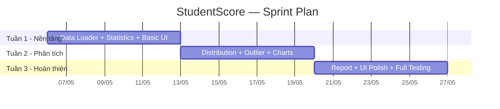
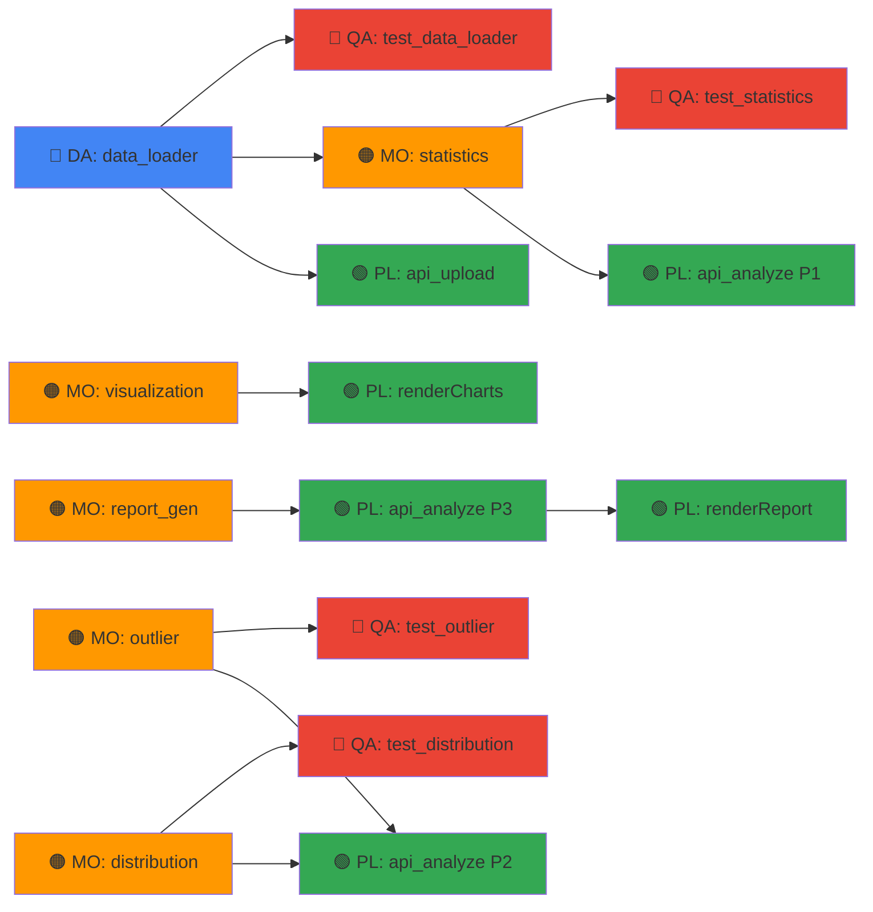

# 📅 Sprint Plan — StudentScore (3 Tuần)

> **Mục tiêu:** Mỗi cuối tuần đều có sản phẩm chạy được, demo được.  
> **Ngày bắt đầu:** 2026-05-06  
> **Ngày kết thúc:** 2026-05-26  
> **Schema:** Cố định 20 cột — Target: `Exam_Score`, 6 numeric features, 13 categorical features

---

## Vai trò & Trách nhiệm

| Vai trò | Ký hiệu | Trách nhiệm chính |
|---------|---------|-------------------|
| **TechLead** | 🟣 TL | Review code, thiết kế API contract, merge PR, quyết định kỹ thuật |
| **Data** | 🔵 DA | Đọc file, validate schema, extract target/features, sample datasets |
| **Pipeline** | 🟢 PL | Flask API, frontend (HTML/CSS/JS), tích hợp end-to-end |
| **Model** | 🟠 MO | Thống kê, kiểm định phân phối, outlier detection, visualization |
| **QA/QC** | 🔴 QA | Unit tests, integration tests, UI tests, edge cases, bug reports |

---

## Tổng quan 3 Tuần

---

## 🗓️ TUẦN 1: Nền tảng & Dữ liệu (05/06 → 05/12)

### 🎯 Mục tiêu tuần
> Upload file CSV → validate schema 20 cột → hiển thị preview + column stats → thống kê mô tả Exam_Score

### Demo cuối tuần 1
- [ ] Upload file → validate đúng/sai schema → hiển thị preview 5 dòng
- [ ] Hiển thị column stats (target, numeric features, categorical features)
- [ ] Bấm Phân tích → hiển thị stats cards (Mean, Median, Std, ...)
- [ ] Giao diện dark mode cơ bản, chạy được trên localhost

---

### 🟣 TechLead (TL) — 5 tasks

| Task | Mô tả | Ngày |
|------|-------|------|
| TL-1.1 | Kick-off: giải thích kiến trúc, schema cố định, API contract | Day 1 |
| TL-1.2 | Review & finalize `config.py` (20 cột, VALID_CATEGORIES) | Day 1 |
| TL-1.3 | Setup git repo, branching strategy, PR template | Day 1 |
| TL-1.4 | Code review PR của DA, PL, MO | Day 3-5 |
| TL-1.5 | Hỗ trợ blocker, quyết định kỹ thuật | Ongoing |

### 🔵 Data (DA) — 6 tasks

| Task | File | Hàm | Mô tả | Ngày |
|------|------|-----|-------|------|
| DA-1.1 | `data_loader.py` | `load_file()` | Đọc CSV/Excel, detect encoding (chardet) | Day 1-2 |
| DA-1.2 | `data_loader.py` | `validate_schema()` | Kiểm tra đủ 20 cột, kiểu dữ liệu, VALID_CATEGORIES | Day 2-3 |
| DA-1.3 | `data_loader.py` | `get_preview()` | Trả về n dòng đầu, NaN → None | Day 3 |
| DA-1.4 | `data_loader.py` | `extract_data()` | Trích xuất target + numeric/categorical features | Day 3-4 |
| DA-1.5 | `data_loader.py` | `clean_series()`, `get_column_stats()` | Clean Series + metadata cột | Day 4 |
| DA-1.6 | `sample_data/` | — | Tạo thêm datasets: file thiếu cột, sai category, có NaN | Day 4-5 |

### 🟢 Pipeline (PL) — 8 tasks

| Task | File | Hàm/Phần | Mô tả | Ngày |
|------|------|----------|-------|------|
| PL-1.1 | `app.py` | `_allowed_file()` | Kiểm tra extension | Day 1 |
| PL-1.2 | `app.py` | `api_upload()` | Upload → validate_schema → get_column_stats → preview | Day 2-3 |
| PL-1.3 | `app.py` | `api_analyze()` Phase 1 | Kết nối stats trên Exam_Score, trả {stats} | Day 3-4 |
| PL-1.4 | `app.py` | `api_sample_data()` | Trả file CSV mẫu | Day 2 |
| PL-1.5 | `index.html` | — | Review HTML structure cho schema cố định (bỏ mapping UI) | Day 1-2 |
| PL-1.6 | `app.js` | `handleFileUpload()` | Drag-drop + click, gọi /api/upload | Day 2-3 |
| PL-1.7 | `app.js` | `renderStats()` | Render statistics cards từ API | Day 4-5 |
| PL-1.8 | `style.css` | — | Dark mode base, glassmorphism cards, upload zone | Day 3-5 |

### 🟠 Model (MO) — 4 tasks

| Task | File | Hàm | Mô tả | Ngày |
|------|------|-----|-------|------|
| MO-1.1 | `statistics_engine.py` | `compute_descriptive_stats()` | 16 chỉ số (mean, median, std, Q1, Q3, IQR, skewness, kurtosis...) | Day 1-3 |
| MO-1.2 | `statistics_engine.py` | `compute_frequency_table()` | Bảng tần số, auto bins | Day 3-4 |
| MO-1.3 | `statistics_engine.py` | `compute_percentile()` | Tính percentile | Day 4 |
| MO-1.4 | — | — | Nghiên cứu & prep Tuần 2 (Shapiro-Wilk, IQR outlier) | Day 5 |

### 🔴 QA/QC (QA) — 8 tasks

| Task | File | Mô tả | Ngày |
|------|------|-------|------|
| QA-1.1 | `test_data_loader.py` | Test `load_file()`: CSV đúng, file rỗng, extension sai (3 tests) | Day 2-3 |
| QA-1.2 | `test_data_loader.py` | Test `validate_schema()`: đúng schema, thiếu cột, thừa cột, rỗng, sai category (5 tests) | Day 3 |
| QA-1.3 | `test_data_loader.py` | Test `extract_data()`: target đúng, numeric shape, categorical shape, NaN dropped (4 tests) | Day 3-4 |
| QA-1.4 | `test_data_loader.py` | Test `clean_series()`: removes NaN, converts to float (2 tests) | Day 4 |
| QA-1.5 | `test_statistics.py` | Test `compute_descriptive_stats()`: mean, median, empty raises, all keys (4 tests) | Day 4-5 |
| QA-1.6 | `test_statistics.py` | Test `compute_frequency_table()`: bin count, frequency sum (2 tests) | Day 5 |
| QA-1.7 | — | Test thủ công UI: upload thành công/thất bại, preview hiển thị đúng | Day 5 |
| QA-1.8 | — | Báo cáo bug & tạo issues | Day 5 |

---

## 🗓️ TUẦN 2: Phân tích Phân phối & Outlier (05/13 → 05/19)

### 🎯 Mục tiêu tuần
> Upload → Phân tích → Biểu đồ tương tác Exam_Score + Bảng outlier + Kiểm định phân phối

### Demo cuối tuần 2
- [ ] 4+ biểu đồ Plotly (Histogram+KDE, Box Plot, QQ Plot, Scatter Outlier)
- [ ] Kiểm định phân phối (Shapiro-Wilk, Anderson-Darling) + nhận xét
- [ ] Bảng outlier kèm phương pháp phát hiện + giải thích
- [ ] Chọn phương pháp outlier (IQR/Z-Score/MAD) + điều chỉnh threshold

---

### 🟣 TechLead (TL) — 4 tasks

| Task | Mô tả | Ngày |
|------|-------|------|
| TL-2.1 | Review PR tuần 2, đảm bảo interface modules nhất quán | Day 1-5 |
| TL-2.2 | Kiểm tra data flow: API → Module → Response → Frontend | Day 3 |
| TL-2.3 | Quyết định Plotly dark theme config thống nhất | Day 1 |
| TL-2.4 | Mid-project review: đánh giá tiến độ, điều chỉnh scope | Day 3 |

### 🔵 Data (DA) — 4 tasks

| Task | File | Mô tả | Ngày |
|------|------|-------|------|
| DA-2.1 | `sample_data/` | Tạo datasets đặc biệt: phân phối chuẩn, lệch trái, lệch phải, bimodal | Day 1-2 |
| DA-2.2 | `data_loader.py` | Fix bugs từ QA tuần 1 | Day 1-2 |
| DA-2.3 | — | Hỗ trợ MO test thuật toán trên edge-case datasets | Day 3-5 |
| DA-2.4 | `sample_data/` | Tạo dataset lớn (1000+ dòng) để test performance | Day 4 |

### 🟢 Pipeline (PL) — 7 tasks

| Task | File | Hàm/Phần | Mô tả | Ngày |
|------|------|----------|-------|------|
| PL-2.1 | `app.py` | `api_analyze()` Phase 2 | Kết nối distribution + outlier | Day 1-2 |
| PL-2.2 | `app.js` | `runAnalysis()` | Thu thập config, gửi request, dispatch render | Day 1-2 |
| PL-2.3 | `app.js` | `renderCharts()` | Parse Plotly JSON, gọi Plotly.newPlot | Day 2-3 |
| PL-2.4 | `app.js` | `renderOutliers()` | Render bảng outlier + highlight rows | Day 3-4 |
| PL-2.5 | `style.css` | — | Charts grid, outlier table, config panel | Day 3-5 |
| PL-2.6 | `app.js` | Event listeners | Threshold slider, checkbox methods | Day 4-5 |
| PL-2.7 | `index.html` | — | Thêm distribution results section | Day 2 |

### 🟠 Model (MO) — 13 tasks

| Task | File | Hàm | Mô tả | Ngày |
|------|------|-----|-------|------|
| MO-2.1 | `distribution_analyzer.py` | `shapiro_wilk_test()` | Shapiro-Wilk, xử lý n≥5000 | Day 1 |
| MO-2.2 | `distribution_analyzer.py` | `anderson_darling_test()` | Anderson-Darling + critical values | Day 1-2 |
| MO-2.3 | `distribution_analyzer.py` | `dagostino_pearson_test()` | D'Agostino-Pearson, check n≥20 | Day 2 |
| MO-2.4 | `distribution_analyzer.py` | `fit_distributions()` | Fit norm, skewnorm, lognorm → SSE/AIC | Day 2-3 |
| MO-2.5 | `distribution_analyzer.py` | `run_all_tests()`, `interpret_results()` | Tổng hợp + nhận xét tiếng Việt | Day 3 |
| MO-2.6 | `outlier_detector.py` | `detect_iqr()` | Outlier IQR + DetectionDetail | Day 3-4 |
| MO-2.7 | `outlier_detector.py` | `detect_zscore()` | Outlier Z-Score | Day 4 |
| MO-2.8 | `outlier_detector.py` | `detect_modified_zscore()` | Outlier MAD | Day 4 |
| MO-2.9 | `outlier_detector.py` | `detect_dbscan()` | Outlier DBSCAN | Day 4-5 |
| MO-2.10 | `outlier_detector.py` | `detect_ensemble()` | Majority voting | Day 5 |
| MO-2.11 | `visualization.py` | `create_histogram_kde()`, `create_box_plot()` | 2 biểu đồ chính | Day 1-2 |
| MO-2.12 | `visualization.py` | `create_qq_plot()`, `create_scatter_outlier()` | 2 biểu đồ outlier | Day 3-4 |
| MO-2.13 | `visualization.py` | `get_chart_layout_defaults()` | Dark theme Plotly layout | Day 1 |

### 🔴 QA/QC (QA) — 8 tasks

| Task | File | Mô tả | Ngày |
|------|------|-------|------|
| QA-2.1 | `test_distribution.py` | Test `shapiro_wilk_test()`: normal pass, skewed fail, result keys (3 tests) | Day 1-2 |
| QA-2.2 | `test_distribution.py` | Test `run_all_tests()`: all fields, Vietnamese conclusion (2 tests) | Day 2-3 |
| QA-2.3 | `test_outlier.py` | Test `detect_iqr()`: known outliers, no outliers, returns detail (3 tests) | Day 3 |
| QA-2.4 | `test_outlier.py` | Test `detect_zscore()`: extreme values, threshold effect (2 tests) | Day 3-4 |
| QA-2.5 | `test_outlier.py` | Test `detect_ensemble()`: majority voting, all method details (2 tests) | Day 4 |
| QA-2.6 | `test_outlier.py` | Test `build_outlier_report()`: format, label included (2 tests) | Day 4-5 |
| QA-2.7 | — | Test tích hợp: upload → analyze → verify full API response | Day 5 |
| QA-2.8 | — | Test UI: charts render, outlier table, threshold slider | Day 5 |

---

## 🗓️ TUẦN 3: Hoàn thiện & Polish (05/20 → 05/26)

### 🎯 Mục tiêu tuần
> Sản phẩm hoàn chỉnh: Report tự động, UI mượt, tất cả test pass, sẵn sàng demo

### Demo cuối tuần 3 (Final)
- [ ] Báo cáo nhận xét tự động tiếng Việt (thống kê, phân phối, outlier, đề xuất)
- [ ] UI hoàn chỉnh: animations, responsive, glassmorphism
- [ ] Violin Plot + Strip Plot hoạt động
- [ ] Tất cả unit tests pass
- [ ] README.md hoàn chỉnh

---

### 🟣 TechLead (TL) — 5 tasks

| Task | Mô tả | Ngày |
|------|-------|------|
| TL-3.1 | Final code review toàn bộ modules | Day 1-2 |
| TL-3.2 | Kiểm tra consistency: naming, error handling, response format | Day 2 |
| TL-3.3 | Viết `README.md`: setup, usage, architecture | Day 3-4 |
| TL-3.4 | Chuẩn bị demo script | Day 4-5 |
| TL-3.5 | Final merge, tag release v1.0 | Day 5 |

### 🔵 Data (DA) — 4 tasks

| Task | File | Mô tả | Ngày |
|------|------|-------|------|
| DA-3.1 | `data_loader.py` | Fix tất cả bugs còn lại từ QA | Day 1 |
| DA-3.2 | `sample_data/` | Finalize bộ dữ liệu demo ấn tượng (có outlier rõ ràng) | Day 1-2 |
| DA-3.3 | — | Viết docs/comments bổ sung cho data_loader | Day 3 |
| DA-3.4 | — | Hỗ trợ QA test edge cases liên quan data | Day 3-5 |

### 🟢 Pipeline (PL) — 7 tasks

| Task | File | Hàm/Phần | Mô tả | Ngày |
|------|------|----------|-------|------|
| PL-3.1 | `app.py` | `api_analyze()` Phase 3 | Kết nối report_generator, response hoàn chỉnh | Day 1 |
| PL-3.2 | `app.js` | `renderReport()` | Render báo cáo nhận xét | Day 1-2 |
| PL-3.3 | `style.css` | — | Polish: animations fadeInUp, hover glow, slider custom | Day 1-3 |
| PL-3.4 | `app.js` | — | Loading states, error handling, toast notifications | Day 2-3 |
| PL-3.5 | `style.css` | — | Responsive breakpoints (tablet/mobile) | Day 3-4 |
| PL-3.6 | `index.html` | — | SEO meta tags, favicon, final review | Day 4 |
| PL-3.7 | — | — | Fix UI bugs từ QA | Day 4-5 |

### 🟠 Model (MO) — 10 tasks

| Task | File | Hàm | Mô tả | Ngày |
|------|------|-----|-------|------|
| MO-3.1 | `outlier_detector.py` | `build_outlier_report()` | Xây dựng OutlierRecord chi tiết | Day 1 |
| MO-3.2 | `outlier_detector.py` | `explain_outlier()` | Giải thích tiếng Việt từng outlier | Day 1-2 |
| MO-3.3 | `report_generator.py` | `generate_statistics_comment()` | Nhận xét thống kê | Day 1-2 |
| MO-3.4 | `report_generator.py` | `generate_distribution_comment()` | Nhận xét phân phối | Day 2 |
| MO-3.5 | `report_generator.py` | `generate_outlier_comment()` | Nhận xét outlier | Day 2-3 |
| MO-3.6 | `report_generator.py` | `generate_recommendation()` | Đề xuất hành động | Day 3 |
| MO-3.7 | `report_generator.py` | `generate_full_report()` | Tổng hợp tất cả | Day 3 |
| MO-3.8 | `visualization.py` | `create_violin_plot()`, `create_strip_plot()` | 2 biểu đồ còn lại | Day 1-2 |
| MO-3.9 | `visualization.py` | `generate_all_charts()` | Tổng hợp charts | Day 2 |
| MO-3.10 | — | — | Fix bugs thuật toán từ QA | Day 4-5 |

### 🔴 QA/QC (QA) — 8 tasks

| Task | File | Mô tả | Ngày |
|------|------|-------|------|
| QA-3.1 | `test_outlier.py` | Bổ sung test `explain_outlier()`, `build_outlier_report()` | Day 1-2 |
| QA-3.2 | — | Viết integration test: upload → analyze → report (end-to-end) | Day 2-3 |
| QA-3.3 | — | Test trên nhiều dataset: phân phối chuẩn, lệch, bimodal, 1000+ rows | Day 3 |
| QA-3.4 | — | Test edge cases: file 1 dòng, tất cả giá trị giống nhau, toàn NaN | Day 3-4 |
| QA-3.5 | — | Test responsive UI (thu nhỏ cửa sổ, tablet viewport) | Day 4 |
| QA-3.6 | `tests/` | Chạy toàn bộ test suite, đảm bảo 100% pass | Day 4-5 |
| QA-3.7 | — | Regression test: verify tất cả bug fixes từ trước | Day 5 |
| QA-3.8 | — | Viết test report cuối cùng & checklist release | Day 5 |

---

## 📊 Tổng hợp Task theo Vai trò

| Vai trò | Tuần 1 | Tuần 2 | Tuần 3 | Tổng |
|---------|--------|--------|--------|------|
| 🟣 TechLead | 5 | 4 | 5 | **14** |
| 🔵 Data | 6 | 4 | 4 | **14** |
| 🟢 Pipeline | 8 | 7 | 7 | **22** |
| 🟠 Model | 4 | 13 | 10 | **27** |
| 🔴 QA/QC | **8** | **8** | **8** | **24** |

## 📊 Tổng hợp theo Module

| Module | Tuần chính | Vai trò chính | Số hàm |
|--------|-----------|---------------|--------|
| `data_loader.py` | Tuần 1 | 🔵 DA | 6 |
| `statistics_engine.py` | Tuần 1 | 🟠 MO | 3 |
| `distribution_analyzer.py` | Tuần 2 | 🟠 MO | 6 |
| `outlier_detector.py` | Tuần 2-3 | 🟠 MO | 7 |
| `visualization.py` | Tuần 2-3 | 🟠 MO | 8 |
| `report_generator.py` | Tuần 3 | 🟠 MO | 6 |
| `app.py` (API) | Tuần 1-3 | 🟢 PL | 4 |
| Frontend (JS/CSS/HTML) | Tuần 1-3 | 🟢 PL | — |
| Tests | Tuần 1-3 | 🔴 QA | 30+ |

---

## ⚠️ Dependencies & Blockers

> [!TIP]
> **Giảm thiểu block:** PL dùng mock data để phát triển UI song song. QA bắt đầu viết test ngay khi module có skeleton (trước khi implement xong).

---

## 🔄 Quy trình làm việc

1. **Daily standup** (15 phút): làm gì hôm qua / hôm nay / blocker
2. **Branch strategy**: `main` ← `dev` ← `feature/DA-1.1`, `feature/MO-2.1`, ...
3. **PR rule**: Mỗi PR cần ít nhất 1 approval từ TechLead
4. **Demo cuối tuần**: Friday — chạy demo trên localhost, thu feedback
5. **Bug tracking**: GitHub Issues, label P0/P1/P2
