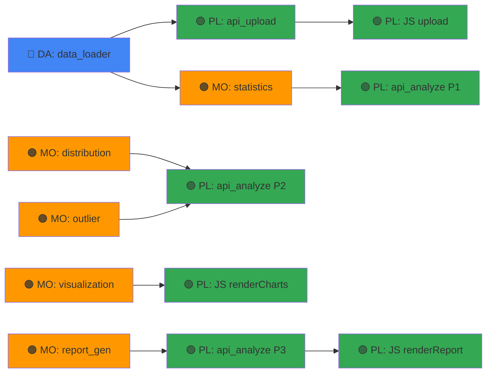

# 📅 Sprint Plan — StudentScore (3 Tuần)

> **Mục tiêu:** Mỗi cuối tuần đều có sản phẩm chạy được, demo được.  
> **Ngày bắt đầu:** 2026-05-06  
> **Ngày kết thúc:** 2026-05-26

---

## Vai trò & Trách nhiệm

| Vai trò | Ký hiệu | Trách nhiệm chính |
|---------|---------|-------------------|
| **TechLead** | 🟣 TL | Review code, thiết kế API contract, merge PR, quyết định kỹ thuật, hỗ trợ blocker |
| **Data** | 🔵 DA | Chuẩn bị dữ liệu, xử lý file I/O, validate, column detection, sample datasets |
| **Pipeline** | 🟢 PL | Flask API, kết nối module, frontend (HTML/CSS/JS), tích hợp end-to-end |
| **Model** | 🟠 MO | Thuật toán thống kê, kiểm định phân phối, outlier detection, visualization |
| **QA/QC** | 🔴 QA | Viết test, kiểm tra edge cases, verify output, kiểm tra UI, báo bug |

---

## Tổng quan 3 Tuần

---

## 🗓️ TUẦN 1: Nền tảng & Dữ liệu (05/06 → 05/12)

### 🎯 Mục tiêu tuần
> Upload file CSV → hệ thống **tự động gợi ý** cột phân tích → xem preview → bấm Phân tích → hiển thị stats cards

### Demo cuối tuần 1
- [ ] Upload file bất kỳ → hiển thị danh sách cột + preview 5 dòng
- [ ] Hệ thống **tự động chọn** cột score/label/group với confidence badge → user chỉ xác nhận
- [ ] Bấm Phân tích → hiển thị stats cards (Mean, Median, Std, ...)
- [ ] Giao diện dark mode cơ bản, chạy được trên localhost

---

### Phân công chi tiết

#### 🟣 TechLead (TL)

| Task | File | Mô tả | Ngày |
|------|------|-------|------|
| TL-1.1 | — | Kick-off meeting: giải thích kiến trúc, API contract, coding conventions | Day 1 |
| TL-1.2 | `config.py` | Review & finalize config, đảm bảo tham số mặc định hợp lý | Day 1 |
| TL-1.3 | — | Setup git repo, branching strategy (main/dev/feature-*), PR template | Day 1 |
| TL-1.4 | — | Code review PR của DA, PL, MO trong tuần | Day 3-5 |
| TL-1.5 | — | Hỗ trợ blocker, quyết định kỹ thuật khi có conflict | Ongoing |

#### 🔵 Data (DA)

| Task | File | Hàm | Mô tả | Ngày |
|------|------|-----|-------|------|
| DA-1.1 | `modules/data_loader.py` | `load_file()` | Đọc CSV/Excel, detect encoding (chardet), detect delimiter | Day 1-2 |
| DA-1.2 | `modules/data_loader.py` | `detect_columns()` | Phân loại cột: numeric / categorical / datetime | Day 2 |
| DA-1.3 | `modules/data_loader.py` | `auto_detect_roles()` | **✨ Mới:** Tự động gợi ý role mapping bằng heuristic (value range, keyword, cardinality) | Day 2-3 |
| DA-1.4 | `modules/data_loader.py` | `get_preview()` | Trả về n dòng đầu, xử lý NaN → None | Day 3 |
| DA-1.5 | `modules/data_loader.py` | `validate_mapping()` | Kiểm tra role mapping hợp lệ (5 rules) | Day 3 |
| DA-1.6 | `modules/data_loader.py` | `extract_by_role()` | Trích xuất Series theo role, gọi clean_series | Day 3-4 |
| DA-1.7 | `modules/data_loader.py` | `clean_series()` | Drop NaN, ép float64 | Day 3 |
| DA-1.8 | `modules/data_loader.py` | `get_groups()`, `filter_by_group()` | Lấy unique groups, lọc theo group | Day 4 |
| DA-1.9 | `sample_data/` | — | Tạo thêm 2-3 bộ dữ liệu mẫu đa dạng (chỉ số, tiếng Anh, có missing) | Day 4-5 |

#### 🟢 Pipeline (PL)

| Task | File | Hàm/Phần | Mô tả | Ngày |
|------|------|----------|-------|------|
| PL-1.1 | `app.py` | `_allowed_file()` | Kiểm tra extension | Day 1 |
| PL-1.2 | `app.py` | `api_upload()` | Nhận file, gọi DA modules + auto_detect_roles, trả JSON {columns, preview, suggested_mapping} | Day 2-3 |
| PL-1.3 | `app.py` | `api_analyze()` — **Phase 1** | Chỉ kết nối stats (chưa dist/outlier), trả {stats} | Day 3-4 |
| PL-1.4 | `app.py` | `api_sample_data()` | Trả file CSV mẫu | Day 2 |
| PL-1.5 | `templates/index.html` | — | Review HTML structure, đảm bảo đúng id/class | Day 1 |
| PL-1.6 | `static/js/app.js` | `handleFileUpload()` | Drag-drop + click upload, gọi /api/upload | Day 2-3 |
| PL-1.7 | `static/js/app.js` | `renderColumnMapping()` | **Pre-fill** dropdowns từ suggested_mapping + hiển thị confidence badge | Day 3-4 |
| PL-1.8 | `static/js/app.js` | `renderPreviewTable()` | Render bảng preview | Day 4 |
| PL-1.9 | `static/js/app.js` | `renderStats()` | Render statistics cards từ API response | Day 4-5 |
| PL-1.10 | `static/css/style.css` | — | Dark mode base, card glassmorphism, upload zone, stats grid | Day 3-5 |

#### 🟠 Model (MO)

| Task | File | Hàm | Mô tả | Ngày |
|------|------|-----|-------|------|
| MO-1.1 | `modules/statistics_engine.py` | `compute_descriptive_stats()` | Tính 16 chỉ số (mean, median, mode, std, Q1, Q3, IQR, skewness, kurtosis, ...) | Day 1-3 |
| MO-1.2 | `modules/statistics_engine.py` | `compute_frequency_table()` | Tạo bảng tần số, auto bins (Sturges/Freedman-Diaconis) | Day 3-4 |
| MO-1.3 | `modules/statistics_engine.py` | `compute_percentile()` | Tính percentile | Day 4 |
| MO-1.4 | — | — | Nghiên cứu & chuẩn bị code cho Tuần 2 (Shapiro-Wilk, IQR outlier) | Day 5 |

#### 🔴 QA/QC (QA)

| Task | File | Mô tả | Ngày |
|------|------|-------|------|
| QA-1.1 | `tests/test_data_loader.py` | Implement tất cả test cases cho data_loader bao gồm auto_detect_roles (11 tests) | Day 3-4 |
| QA-1.2 | `tests/test_statistics.py` | Implement test cases cho statistics_engine (6 tests) | Day 4-5 |
| QA-1.3 | — | Test thủ công: upload CSV đúng/sai format, file rỗng, file quá lớn | Day 5 |
| QA-1.4 | — | Test UI: drag-drop hoạt động, auto-detect chọn đúng cột, confidence badge đúng màu | Day 5 |
| QA-1.5 | — | Báo cáo bug & tạo issue trên git | Day 5 |

---

## 🗓️ TUẦN 2: Phân tích Phân phối & Outlier (05/13 → 05/19)

### 🎯 Mục tiêu tuần
> Chạy đầy đủ pipeline: Upload → Mapping → Phân tích → Biểu đồ tương tác + Bảng outlier

### Demo cuối tuần 2
- [ ] Hiển thị 4+ biểu đồ Plotly (Histogram+KDE, Box Plot, QQ Plot, Scatter Outlier)
- [ ] Kiểm định phân phối (Shapiro-Wilk, Anderson-Darling) → hiển thị kết quả + nhận xét
- [ ] Bảng outlier: danh sách giá trị bất thường kèm phương pháp phát hiện + giải thích
- [ ] Chọn được phương pháp outlier (IQR/Z-Score/MAD) và điều chỉnh threshold

---

### Phân công chi tiết

#### 🟣 TechLead (TL)

| Task | Mô tả | Ngày |
|------|-------|------|
| TL-2.1 | Review PR tuần 2, đảm bảo interface giữa modules nhất quán | Day 1-5 |
| TL-2.2 | Kiểm tra data flow: API → Module → Response → Frontend render | Day 3 |
| TL-2.3 | Quyết định Plotly chart theme (dark mode config) thống nhất | Day 1 |
| TL-2.4 | Mid-project review: đánh giá tiến độ, điều chỉnh scope nếu cần | Day 3 |

#### 🔵 Data (DA)

| Task | File | Mô tả | Ngày |
|------|------|-------|------|
| DA-2.1 | `sample_data/` | Tạo dataset đặc biệt: phân phối chuẩn, lệch trái, lệch phải, bimodal | Day 1-2 |
| DA-2.2 | `modules/data_loader.py` | Fix bugs từ QA tuần 1, cải thiện encoding detection | Day 1-2 |
| DA-2.3 | — | Hỗ trợ MO test thuật toán trên các dataset edge-case | Day 3-5 |
| DA-2.4 | `sample_data/` | Tạo dataset lớn (1000+ dòng) để test performance | Day 4 |

#### 🟢 Pipeline (PL)

| Task | File | Hàm/Phần | Mô tả | Ngày |
|------|------|----------|-------|------|
| PL-2.1 | `app.py` | `api_analyze()` — **Phase 2** | Kết nối distribution_analyzer + outlier_detector | Day 1-2 |
| PL-2.2 | `static/js/app.js` | `runAnalysis()` | Hoàn thiện: thu thập config, gửi request, dispatch render | Day 1-2 |
| PL-2.3 | `static/js/app.js` | `renderCharts()` | Parse Plotly JSON, gọi Plotly.newPlot cho từng container | Day 2-3 |
| PL-2.4 | `static/js/app.js` | `renderOutliers()` | Render bảng outlier với highlight rows | Day 3-4 |
| PL-2.5 | `static/css/style.css` | — | Charts grid, outlier table styling, responsive, config panel | Day 3-5 |
| PL-2.6 | `static/js/app.js` | Event listeners | Threshold slider, checkbox methods, group filter dropdown | Day 4-5 |
| PL-2.7 | `templates/index.html` | — | Thêm distribution results section nếu cần | Day 2 |

#### 🟠 Model (MO)

| Task | File | Hàm | Mô tả | Ngày |
|------|------|-----|-------|------|
| MO-2.1 | `modules/distribution_analyzer.py` | `shapiro_wilk_test()` | Kiểm định Shapiro-Wilk, xử lý n≥5000 | Day 1 |
| MO-2.2 | `modules/distribution_analyzer.py` | `anderson_darling_test()` | Kiểm định Anderson-Darling + critical values | Day 1-2 |
| MO-2.3 | `modules/distribution_analyzer.py` | `dagostino_pearson_test()` | Kiểm định D'Agostino-Pearson, check n≥20 | Day 2 |
| MO-2.4 | `modules/distribution_analyzer.py` | `fit_distributions()` | Fit norm, skewnorm, lognorm, beta → SSE/AIC | Day 2-3 |
| MO-2.5 | `modules/distribution_analyzer.py` | `run_all_tests()`, `interpret_results()` | Tổng hợp + sinh nhận xét tiếng Việt | Day 3 |
| MO-2.6 | `modules/outlier_detector.py` | `detect_iqr()` | Outlier bằng IQR + trả DetectionDetail | Day 3-4 |
| MO-2.7 | `modules/outlier_detector.py` | `detect_zscore()` | Outlier bằng Z-Score | Day 4 |
| MO-2.8 | `modules/outlier_detector.py` | `detect_modified_zscore()` | Outlier bằng MAD | Day 4 |
| MO-2.9 | `modules/outlier_detector.py` | `detect_dbscan()` | Outlier bằng DBSCAN (StandardScaler + fit) | Day 4-5 |
| MO-2.10 | `modules/outlier_detector.py` | `detect_ensemble()` | Majority voting | Day 5 |
| MO-2.11 | `modules/visualization.py` | `create_histogram_kde()`, `create_box_plot()` | 2 biểu đồ chính | Day 1-2 |
| MO-2.12 | `modules/visualization.py` | `create_qq_plot()`, `create_scatter_outlier()` | 2 biểu đồ outlier | Day 3-4 |
| MO-2.13 | `modules/visualization.py` | `get_chart_layout_defaults()` | Dark theme Plotly layout | Day 1 |

#### 🔴 QA/QC (QA)

| Task | File | Mô tả | Ngày |
|------|------|-------|------|
| QA-2.1 | `tests/test_distribution.py` | Implement 5 test cases: normal pass, skewed fail, result format | Day 2-3 |
| QA-2.2 | `tests/test_outlier.py` | Implement 8 test cases: IQR, Z-Score, ensemble, report format | Day 3-4 |
| QA-2.3 | — | Test tích hợp: upload → analyze → verify API response đầy đủ | Day 4-5 |
| QA-2.4 | — | Test UI: charts render, outlier table highlight, threshold slider | Day 5 |
| QA-2.5 | — | Test edge cases: file 1 dòng, tất cả giống nhau, toàn NaN | Day 5 |

---

## 🗓️ TUẦN 3: Hoàn thiện & Polish (05/20 → 05/26)

### 🎯 Mục tiêu tuần
> Sản phẩm hoàn chỉnh: Report tự động, UI đẹp mượt, tất cả test pass, sẵn sàng demo

### Demo cuối tuần 3 (Final)
- [ ] Báo cáo nhận xét tự động bằng tiếng Việt (thống kê, phân phối, outlier, đề xuất)
- [ ] UI hoàn chỉnh: animations, responsive, glassmorphism, micro-interactions
- [ ] Violin Plot + Strip Plot hoạt động
- [ ] Tất cả unit tests pass (23+ tests)
- [ ] README.md hoàn chỉnh

---

### Phân công chi tiết

#### 🟣 TechLead (TL)

| Task | Mô tả | Ngày |
|------|-------|------|
| TL-3.1 | Final code review toàn bộ modules | Day 1-2 |
| TL-3.2 | Kiểm tra consistency: naming, error handling, response format | Day 2 |
| TL-3.3 | Viết `README.md`: setup, usage, screenshots, architecture | Day 3-4 |
| TL-3.4 | Chuẩn bị slide/demo script cho presentation | Day 4-5 |
| TL-3.5 | Final merge, tag release v1.0 | Day 5 |

#### 🔵 Data (DA)

| Task | File | Mô tả | Ngày |
|------|------|-------|------|
| DA-3.1 | `modules/data_loader.py` | Fix tất cả bugs còn lại từ QA | Day 1 |
| DA-3.2 | `sample_data/` | Finalize bộ dữ liệu mẫu: đảm bảo demo ấn tượng (có outlier rõ ràng) | Day 1-2 |
| DA-3.3 | — | Viết docs/comments bổ sung cho data_loader | Day 3 |
| DA-3.4 | — | Hỗ trợ QA test edge cases liên quan data | Day 3-5 |

#### 🟢 Pipeline (PL)

| Task | File | Hàm/Phần | Mô tả | Ngày |
|------|------|----------|-------|------|
| PL-3.1 | `app.py` | `api_analyze()` — **Phase 3** | Kết nối report_generator, trả response hoàn chỉnh | Day 1 |
| PL-3.2 | `static/js/app.js` | `renderReport()` | Render báo cáo nhận xét (markdown → HTML) | Day 1-2 |
| PL-3.3 | `static/css/style.css` | — | **Polish UI**: animations fadeInUp, hover glow, slider custom, responsive | Day 1-3 |
| PL-3.4 | `static/js/app.js` | — | Loading states, error handling, toast notifications | Day 2-3 |
| PL-3.5 | `static/css/style.css` | — | Responsive breakpoints (tablet/mobile) | Day 3-4 |
| PL-3.6 | `templates/index.html` | — | SEO meta tags, favicon, final structure review | Day 4 |
| PL-3.7 | — | — | Fix UI bugs từ QA | Day 4-5 |

#### 🟠 Model (MO)

| Task | File | Hàm | Mô tả | Ngày |
|------|------|-----|-------|------|
| MO-3.1 | `modules/outlier_detector.py` | `build_outlier_report()` | Xây dựng OutlierRecord chi tiết | Day 1 |
| MO-3.2 | `modules/outlier_detector.py` | `explain_outlier()` | Sinh giải thích tiếng Việt cho từng outlier | Day 1-2 |
| MO-3.3 | `modules/report_generator.py` | `generate_statistics_comment()` | Nhận xét thống kê (mean vs median, CV, range) | Day 1-2 |
| MO-3.4 | `modules/report_generator.py` | `generate_distribution_comment()` | Nhận xét phân phối (chuẩn/không, lệch, ý nghĩa) | Day 2 |
| MO-3.5 | `modules/report_generator.py` | `generate_outlier_comment()` | Nhận xét outlier (số lượng, vị trí, severity) | Day 2-3 |
| MO-3.6 | `modules/report_generator.py` | `generate_recommendation()` | Đề xuất hành động cho giáo viên | Day 3 |
| MO-3.7 | `modules/report_generator.py` | `generate_full_report()` | Tổng hợp tất cả | Day 3 |
| MO-3.8 | `modules/visualization.py` | `create_violin_plot()`, `create_strip_plot()` | 2 biểu đồ còn lại | Day 1-2 |
| MO-3.9 | `modules/visualization.py` | `generate_all_charts()` | Tổng hợp tất cả charts | Day 2 |
| MO-3.10 | — | — | Fix bugs thuật toán từ QA | Day 4-5 |

#### 🔴 QA/QC (QA)

| Task | File | Mô tả | Ngày |
|------|------|-------|------|
| QA-3.1 | `tests/` | Chạy toàn bộ test suite, đảm bảo 100% pass | Day 2-3 |
| QA-3.2 | — | Test end-to-end hoàn chỉnh: upload → analyze → report → mọi thứ render | Day 3 |
| QA-3.3 | — | Test trên nhiều dataset mẫu: phân phối chuẩn, lệch, bimodal | Day 3-4 |
| QA-3.4 | — | Test responsive UI (thu nhỏ cửa sổ, tablet viewport) | Day 4 |
| QA-3.5 | — | Regression test: verify tất cả bug fixes từ trước | Day 4-5 |
| QA-3.6 | — | Viết test report cuối cùng | Day 5 |

---

## 📊 Tổng hợp Task theo Vai trò

| Vai trò | Tuần 1 | Tuần 2 | Tuần 3 | Tổng tasks |
|---------|--------|--------|--------|------------|
| 🟣 TechLead | 5 | 4 | 5 | **14** |
| 🔵 Data | 9 | 4 | 4 | **17** |
| 🟢 Pipeline | 10 | 7 | 7 | **24** |
| 🟠 Model | 4 | 13 | 10 | **27** |
| 🔴 QA/QC | 5 | 5 | 6 | **16** |

## 📊 Tổng hợp theo Module

| Module | Tuần chính | Vai trò chính | Số hàm |
|--------|-----------|---------------|--------|
| `data_loader.py` | Tuần 1 | 🔵 DA | 9 (bao gồm auto_detect_roles) |
| `statistics_engine.py` | Tuần 1 | 🟠 MO | 3 |
| `distribution_analyzer.py` | Tuần 2 | 🟠 MO | 6 |
| `outlier_detector.py` | Tuần 2-3 | 🟠 MO | 7 |
| `visualization.py` | Tuần 2-3 | 🟠 MO | 8 |
| `report_generator.py` | Tuần 3 | 🟠 MO | 6 |
| `app.py` (API) | Tuần 1-3 | 🟢 PL | 4 |
| Frontend (JS/CSS/HTML) | Tuần 1-3 | 🟢 PL | — |
| Tests | Tuần 1-3 | 🔴 QA | 23+ |

---

## ⚠️ Dependencies & Blockers tiềm năng

> [!WARNING]
> **Blocker chính:** Pipeline (PL) phụ thuộc vào output của Data (DA) và Model (MO). Nếu DA hoặc MO chậm, PL sẽ bị block. TechLead cần monitor dependency chain hàng ngày.

> [!TIP]
> **Giảm thiểu block:** PL có thể dùng mock data / hardcoded response để phát triển UI song song trong khi chờ DA và MO hoàn thành module thực.

---

## 🔄 Quy trình làm việc

1. **Daily standup** (15 phút): Mỗi người báo cáo — làm gì hôm qua / hôm nay / blocker
2. **Branch strategy**: `main` ← `dev` ← `feature/DA-1.1`, `feature/MO-2.1`, ...
3. **PR rule**: Mỗi PR cần ít nhất 1 approval từ TechLead
4. **Demo cuối tuần**: Friday — chạy demo trên localhost, thu feedback
5. **Bug tracking**: Tạo GitHub Issues, label theo priority (P0/P1/P2)
